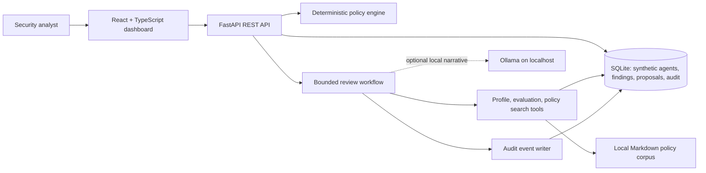
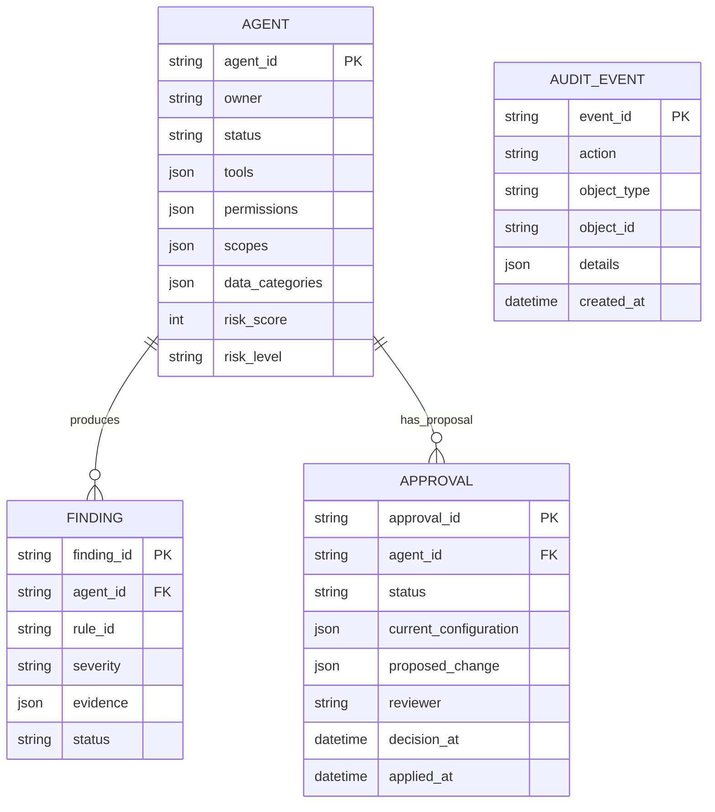

# SentinelAI Architecture

## Application Flow

The deterministic engine is the authority for rule matches and numerical scores. The optional Ollama endpoint can summarize only the structured evidence already returned by the tools. If unavailable or malformed, the workflow returns a clearly labeled deterministic fallback.

## Data Model

`AUDIT_EVENT` is append-only through application routes and is intentionally independent of user PII. SQLite initializes at `backend/sentinelai.db` and seed creation is idempotent.

## Boundaries

- The agent has three fixed, schema-validated tools; no shell, arbitrary filesystem, external scanning, or live account mutation tools exist.
- Policy citations point to sections in `backend/app/policies/governance.md`.
- Proposals are inert records. Approval and explicit apply confirmation are separate requests.
- Apply operations mutate only local synthetic SQLite rows and are recorded in audit events.
